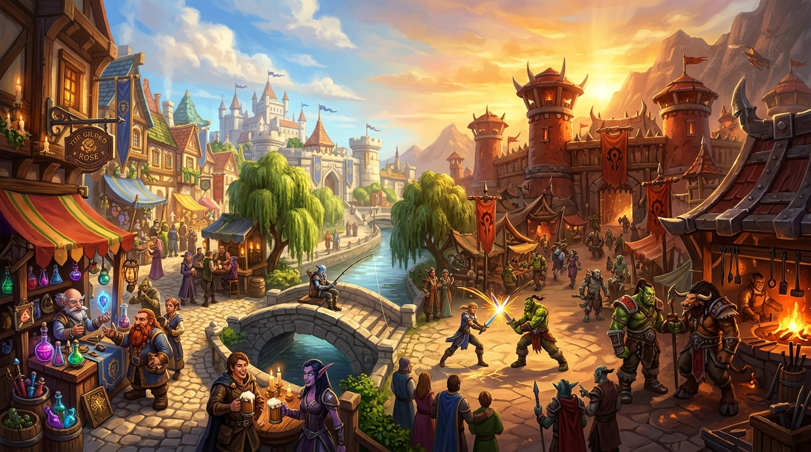

# City Life (Comprehensive Autonomous Urban Population & Roleplay)



Repository/module name: `mod-playerbots-city-life`  
Created by **iCore**. Incorporates 100% of capabilities and micro-behaviors from `mod-city-bots`.

City Life populates capitals, towns, and popular social hubs with configurable AzerothCore Playerbots. It makes cities feel lively, bustling, and immersive: residents wander between districts, shop at market stalls, socialize in taverns, fish along city waterways, and gather to cheer the duels outside the capital gates.

**Single Installed Module Requirement:** Users install only `mod-playerbots-city-life` alongside AzerothCore and `mod-playerbots`. `mod-city-bots` is completely unnecessary and should not be installed or enabled.

---

## Key Features & Subsystems

- **Living Urban Population:** Per-hub population settings across 16+ bundled cities and hubs (Stormwind, Orgrimmar, Ironforge, Undercity, Darnassus, Thunder Bluff, Exodar, Silvermoon, Shattrath, Dalaran, Gadgetzan, Goldshire, Honor Hold, Thrallmar, Wintergrasp camps).
- **Multi-District Exploration:** Bots periodically explore alternating districts (e.g. Mage Quarter -> Trade District -> Old Town -> Cathedral Square) rather than staying fixed to one area.
- **Duel Spectators:** Residents gather at the duel grounds outside the Stormwind and Orgrimmar gates and in Goldshire, face the nearest duel in progress and cheer it on, stepping back when a fight comes too close. The duels themselves are `mod-hearthside-pvp`'s (`PvPLife.Duel.*`); City Life runs none.
- **Civic Routines:** Roaming residents pick their next activity by configurable weights (`CityLife.Weight.*`): visiting their own class trainer, the mailbox, the auction house or a food vendor, sitting or drinking in a tavern (on a chair when one is near), walking the walls, fishing at the docks. Inn dancers and fishers rest between sets; a resident whose stay is over sleeps at the inn before it leaves.
- **Canal Water Avoidance:** Automated terrain and water-depth detection prevents bots from falling into Stormwind canals or drowning, automatically snapping waypoints to dry quays and stone bridges.
- **Weighted Hotspot Distribution:** Dynamic distribution across functional categories: `auction`, `bank`, `mail`, `flight`, `square`, `tavern`, and `travel`. Auction house and bank spots receive boosted weighting with stationary patron ratios.
- **Time-of-Day Dynamic Scaling:** Realistic morning, daytime, evening, and nighttime population curves with gradual arrivals and departures.
- **Seen Arrivals and Departures:** An empty city keeps a population floor, and fills up one resident at a time while a player is there. Residents a player could see walk in from out of sight and walk off when they leave, instead of appearing and vanishing in a teleport.
- **Mutual Anti-Stealing Reservation Barrier:** Thread-safe, standalone-safe shared reservation registry (`PlayerbotsLife::ReservationRegistry`) ensuring bots reserved by City Life are never stolen or commanded by `mod-playerbots-pvp-life`, and vice versa.
- **Conservative Population Borrowing Budget:** Strict default cap of 10% eligible pool / 120 bots max (configured for a 1,000-bot server) guarantees that ≥ 80% (800+ bots) of random playerbots remain completely free to roam, quest, run dungeons, and engage in open-world activities.
- **Zero Bot Tampering Invariant:** Bots are borrowed strictly AS-IS from the natural Playerbot pool with zero artificial level modifications, zero talent changes, and zero stat inflation.
- **Zero GM Spam Protection:** Game Masters and administrators are strictly exempt from greetings, whispers, or broadcasts.
- **Silent-by-Default Operation:** All ambient speech, scripted dialogues, and greetings default to OFF (`0`) in config for a completely unobtrusive server experience out of the box.
- **Instant Disengagement on Invite or Logout:** Residents immediately drop city behaviors if invited to a player group, commanded by an owner, or logged out.
- **Coexistence with `mod-hearthside-pvp`:** Both modules run side by side on one shared reservation registry; PvP Life runs the duels and City Life sends the crowd.
- **Comprehensive GM Commands:** Real-time runtime tools for tuning hubs, recording exact hotspot coordinates in-game, and monitoring system health.

---

## Requirements

- [`mod-playerbots/azerothcore-wotlk`, Playerbot branch](https://github.com/mod-playerbots/azerothcore-wotlk/tree/Playerbot)
- [`mod-playerbots/mod-playerbots`, master branch](https://github.com/mod-playerbots/mod-playerbots)
- C++17-capable build environment (AzerothCore baseline).
- MySQL database (AzerothCore baseline).

---

## Installation & Setup

1. Place `mod-hearthside-city` into your `modules/` directory:
   ```text
   azerothcore-wotlk/modules/mod-hearthside-city
   ```
2. Nothing to apply by hand: AzerothCore's updater applies `data/sql/db-world/base/city_life.sql`
   to the **WORLD** database on the next worldserver start (`Updates.EnableDatabases` must include
   the world database). The file is idempotent and keeps hubs/spots you have edited.
3. Re-run CMake and rebuild AzerothCore.
4. Copy `conf/mod_playerbots_city_life.conf.dist` to `mod_playerbots_city_life.conf` in your worldserver config directory and customize settings.
5. Start worldserver and look for `>> Loaded mod-playerbots-city-life` in your startup log.

---

## Coexistence with `mod-playerbots-pvp-life`

`mod-playerbots-city-life` and `mod-playerbots-pvp-life` are architected for seamless, zero-conflict simultaneous execution:
- **Zero Feature Suppression:** Neither module disables or yields any feature for the other.
- **Duels belong to PvP Life:** PvP Life's StormwindDuel, OrgrimmarDuel and GoldshireDuel zones run the duels; City Life's StormwindGate, OrgrimmarGate and GoldshireDuel hubs only hold spectators. Without PvP Life the spectators simply wait at their stands.
- **Candidate Scanning Isolation:** During candidate scanning, each module verifies `!PlayerbotsLife::IsReserved(guid)` before borrowing a bot.
- **Shared Reservation Registry:** `src/LifeBotReservation.h` provides an atomic, mutex-guarded process-wide singleton that registers active modules and tracks ownership cleanly.
- **Independent Execution:** If only one module is installed, it runs completely standalone with zero dependencies or overhead.

---

## GM Commands Reference

All administrative commands use the `.citylife` root:

### Status & Diagnostics
- `.citylife status`: Displays total active residents, hub breakdowns, activity states, and borrowing budgets.
- `.citylife compat`: Reports detected active Life modules (`CityLife`, `PvPLife`, `Artisans`) and reservation pool statistics.
- `.citylife reload [config|data|all]`: Reloads configuration and/or hub/hotspot data from the database. Running residents keep going; only the first start waits out `CityLife.StartupDelaySeconds`.

### Hub Management
- `.citylife hub list`: Lists all configured city hubs and their target populations.
- `.citylife hub add <name> <alliance|horde|any> <minLvl> <maxLvl> <pop> [priority]`: Creates a new hub at the GM's current position.
- `.citylife hub population <name> <count>`: Adjusts the default population for a hub.
- `.citylife hub enable <name>`: Enables a hub.
- `.citylife hub disable <name>`: Disables a hub.

### Hotspot Management
- `.citylife spot list <hub>`: Lists all hotspots defined for a hub.
- `.citylife spot add <hub> <name> <category> [weight] [radius]`: Creates or updates a hotspot at the GM's current position.
- `.citylife spot delete <hub> <name>`: Removes a hotspot from a hub. The row is disabled rather than deleted, so a re-applied `city_life.sql` does not bring a seeded spot back; `spot add` with the same name re-enables it.

---

## Scope & Philosophy

City Life intentionally does not:
- Create auction listings or buy items from real players;
- Simulate banking or mailbox transactions;
- Create or force-login offline characters;
- Replace core Playerbots combat AI or talent trees;
- Teleport or interfere with real players and player-owned bots.

Its focus is singular and polished: bring Azeroth's cities to vibrant, believable life while preserving server performance and game integrity.

---

## Credits & Attribution

- **City Life Architecture & Implementation:** Created by **iCore**.
- **Micro-Behaviors & Waypoint Navigation:** Ported and expanded from `mod-city-bots`.
- **Cross-Module Reservation Protocol:** Designed for the Playerbots Life ecosystem (`mod-playerbots-city-life`, `mod-playerbots-pvp-life`, `mod-playerbots-artisans`).
